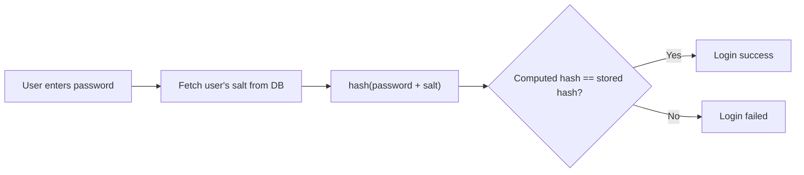

# System Design: How to store passwords in the database?

- **Topic:** SYSTEM DESIGN
- **Video:** [System Design: How to store passwords in the database?](https://www.youtube.com/watch?v=zt8Cocdy15c)
- **Date:** 25 Sep 2026

## Goal

- Store passwords such that **even if the database is compromised**, the attacker cannot recover the actual passwords.
- At login, the user's entered password must be **validatable** against the data in the DB.

## What NOT to Do (Anti-pattern)

- **Do not store passwords in plain text.**
  - Anyone with internal DB access can read every password.
  - If the DB leaks, the attacker gets all passwords at once.

## OWASP Guidelines (what to do)

**OWASP** (Open Web Application Security Project) gives 2 main recommendations for password storage:

### 1. Use a Modern (slow) Hashing Algorithm

- **Hashing = one-way function** — recovering the original password from the hash is impossible (it cannot be decrypted).
- Even if the attacker obtains the hash, they cannot enter it into the app to log in.
- Use a **specially designed, "slow" hashing function** for passwords — it consumes more resources (CPU/memory) to compute.
- Benefit of slowness: **brute force attacks** become costly and unattractive (each guess costs the attacker time).

| Type | Examples | Suitable for passwords? |
|------|----------|-------------------------|
| **Fast hash** (legacy / general purpose) | `MD5`, `SHA-1` | ❌ No — an attacker can try billions of guesses per second |
| **Slow hash** (password-specific) | `bcrypt`, `scrypt`, `Argon2`, `PBKDF2` *(not named in the video, listed for reference only)* | ✅ Yes |

> **Gotcha:** `SHA-256` also belongs to the "fast" family — it is a secure hash, but not sufficient on its own for password storage. Passwords always need a slow, resource-heavy algorithm.

### 2. Salt the Password

- **Salt** = a **unique, randomly generated string** per password, combined with the password before hashing.
- **Why is salt necessary?** A one-way hash alone is not enough — an attacker can break hashes via **pre-computation attacks**:
  - **Rainbow tables** — hashes of common passwords pre-computed and stored in advance.
  - **Database-based lookups** — searching a leaked hash in a ready-made hash database.
  - These techniques can **crack a password in seconds**.
- Adding a salt makes **every password's hash unique** (even if 2 users share the same password, their hashes differ).
- This renders pre-computed tables useless — the attacker must compute separately for each salt.

> **Important:** The salt is **not secret**. It can safely be stored in **plain text** in the DB alongside the hash. Its only job is to make the hash unique.

## Password Storage Flow (Sign-up / Password set)

1. Take the user's password.
2. Generate a **random salt** (different for each user/password).
3. Combine `password + salt`.
4. Compute the **hash** of the combination (using a slow hashing function).
5. Store **both the hash and the salt** in the DB. The original password is never stored anywhere.

```text
password + salt  --(slow hash fn)-->  hash
DB row: { user_id, hash, salt }
```

## Password Validation Flow (Login)

1. Take the user's username + entered password.
2. Fetch that user's **salt** from the DB.
3. Hash `entered_password + salt` with the same hashing function.
4. **Compare** the computed hash with the hash stored in the DB.
5. Match → password valid. Mismatch → invalid.



## Key Takeaways

- Plain text passwords = never.
- A hash is **one-way**, so even a leaked hash does not directly reveal the password.
- Do not use a **fast hash** (`MD5`, `SHA-1`) — use a **slow, password-specific hash** so brute force is expensive.
- **Salt** is a unique random string per password — it neutralizes rainbow table / lookup attacks.
- Salt is not secret and can be stored in plain text. Store both hash + salt in the DB.
- Login = same salt + same hash function → compare hashes.

> **Interview tip:** "Why hashing and not encryption?" — Encryption is two-way (can be decrypted with the key); hashing is one-way. There is never a need to recover the password, only to compare it — hence hashing.
