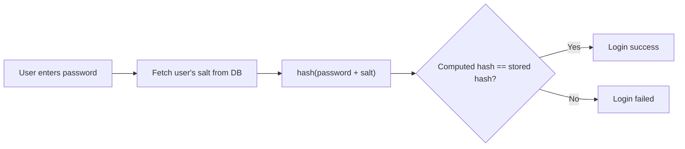

# System Design: How to store passwords in the database?

- **Topic:** SYSTEM DESIGN
- **Video:** [System Design: How to store passwords in the database?](https://www.youtube.com/watch?v=zt8Cocdy15c)
- **Date:** 25 Sep 2026

## Goal kya hai?

- Password aise store karo ki **database compromise hone par bhi** attacker ko asli password na mile.
- Login par user ka entered password DB wale data se **validate** ho sake.

## Kya NAHI karna (Anti-pattern)

- **Plain text me password store mat karo.**
  - Jisko bhi DB ka internal access hai, wo saare passwords padh sakta hai.
  - DB leak hua toh attacker ko ek saath saare passwords mil jaate hain.

## OWASP Guidelines (kya karna hai)

**OWASP** (Open Web Application Security Project) password storage ke liye 2 main recommendations deta hai:

### 1. Modern (slow) hashing algorithm use karo

- **Hashing = one-way function** — hash se wapas original password nikalna impossible hai (decrypt nahi hota).
- Attacker ko hash mil bhi jaaye, wo use app me daal ke login nahi kar sakta.
- Password ke liye **specially designed, "slow" hashing function** use karo — ye compute karne me zyada resources (CPU/memory) leta hai.
- Slow hone ka fayda: **brute force attack** costly aur unattractive ho jaata hai (attacker ko har guess pe time lagta hai).

| Type | Examples | Password ke liye? |
|------|----------|-------------------|
| **Fast hash** (legacy / general purpose) | `MD5`, `SHA-1` | ❌ Nahi — attacker per second billions guesses try kar sakta hai |
| **Slow hash** (password-specific) | `bcrypt`, `scrypt`, `Argon2`, `PBKDF2` *(video me naam nahi liye, sirf reference ke liye)* | ✅ Haan |

> **Gotcha:** `SHA-256` bhi "fast" family ka hai — ye secure hash hai, lekin password storage ke liye akela kaafi nahi. Password ke liye hamesha slow, resource-heavy algorithm chahiye.

### 2. Password ko Salt karo

- **Salt** = har password ke liye ek **unique, randomly generated string**, jo hashing se pehle password ke saath jodi jaati hai.
- **Salt kyun zaroori hai?** Sirf one-way hash kaafi nahi hai — attacker **pre-computation attacks** se hash tod sakta hai:
  - **Rainbow tables** — common passwords ke hashes pehle se compute karke rakhe hote hain.
  - **Database-based lookups** — leaked hash ko ready-made hash database me search karna.
  - In techniques se password **seconds me crack** ho sakta hai.
- Salt add karne se **har password ka hash unique** ban jaata hai (2 users ka same password ho toh bhi hash alag).
- Isse pre-computed tables bekaar ho jaati hain — attacker ko har salt ke liye alag se compute karna padega.

> **Important:** Salt **secret nahi hoti**. Ise DB me **plain text** me hash ke saath safely store kar sakte ho. Iska kaam sirf hash ko unique banana hai.

## Password store karne ka flow (Sign-up / Password set)

1. User ka password lo.
2. Ek **random salt** generate karo (har user/password ke liye alag).
3. `password + salt` ko combine karo.
4. Combination ka **hash** nikalo (slow hashing function se).
5. DB me **hash aur salt dono** store karo. Original password kahin store nahi hota.

```text
password + salt  --(slow hash fn)-->  hash
DB row: { user_id, hash, salt }
```

## Password validate karne ka flow (Login)

1. User ka username + entered password lo.
2. DB se us user ki **salt** fetch karo.
3. `entered_password + salt` ko wahi hashing function se hash karo.
4. Computed hash ko DB me stored hash se **compare** karo.
5. Same hai → password valid. Alag hai → invalid.



## Key Takeaways

- Plain text password = kabhi nahi.
- Hash **one-way** hota hai, isliye hash leak hone par bhi password direct nahi milta.
- **Fast hash** (`MD5`, `SHA-1`) mat use karo — **slow, password-specific hash** use karo taaki brute force mehenga pade.
- **Salt** har password ke liye unique random string hai — rainbow table / lookup attacks ko bekaar kar deti hai.
- Salt secret nahi, plain text me store ho sakti hai. Hash + salt dono DB me rakho.
- Login = same salt + same hash function → compare hashes.

> **Interview tip:** "Hashing kyun, encryption kyun nahi?" — Encryption two-way hai (key se decrypt ho sakta hai), hashing one-way. Password ko kabhi wapas nikalne ki zaroorat hi nahi hoti, sirf compare karna hota hai — isliye hashing.
