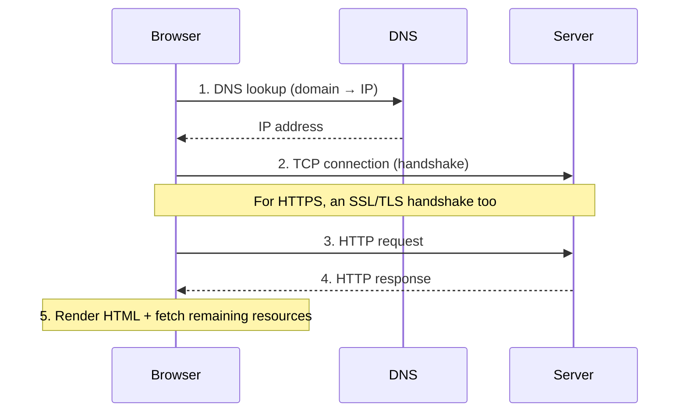

# What happens when you type a URL into your browser?

- **Topic:** SYSTEM DESIGN
- **Video:** [What happens when you type a URL into your browser? (ByteByteGo)](https://www.youtube.com/watch?v=AlkDbnbv7dk)
- **Date:** 05 Sep 2026

## What is a URL?

**URL** = Uniform Resource Locator. It has 4 parts:

| Part | Example | Meaning |
|------|---------|---------|
| **Scheme** | `http://` | Tells the browser which protocol to use. With `https://` the connection is **encrypted**. |
| **Domain** | `example.com` | The site's domain name. |
| **Path** | `/products/` | Think of it as a directory on the server. |
| **Resource** | `phone.html` | Think of it as a file. |

- The distinction between path and resource is often unclear — simple rule: they map to the **directory and file** of a regular file system. Together they identify which resource to load from the server.

## Overall Flow

## Step 1: DNS Lookup

- **DNS (Domain Name System)** = the **phone book** of the internet. Translates a domain name into an **IP address** so the browser can reach the server.
- To keep lookups fast, DNS info is **heavily cached** — at every level:
  1. **Browser cache** — the browser itself caches the answer for a short time.
  2. **OS cache** — if not in the browser cache, the browser asks the operating system; the OS also caches for a short period.
  3. **DNS resolver** — if the OS doesn't have it either, a query goes to a DNS resolver on the internet. This triggers a chain of requests until the IP is resolved.
- **Many servers** in the DNS infrastructure are involved in this process, and the **answer is cached at every step**.

## Step 2: TCP Connection

- Once it has the IP address, the browser establishes a **TCP connection** with the server.
- Establishing a TCP connection involves a **handshake** — this takes **several network round trips** (i.e. it is costly).
- Hence modern browsers use **keep-alive connections** — an established TCP connection is **reused** repeatedly to keep page loading fast.

### Extra Work for HTTPS

- With HTTPS, creating a new connection is even **more expensive** — it requires an **SSL/TLS handshake** that sets up an encrypted connection between browser and server.
- This handshake is expensive, so browsers use tricks like **SSL session resumption** to reduce the cost (reuse a previous session instead of doing a full handshake).

## Step 3-4: HTTP Request & Response

- The browser sends an **HTTP request** over the established TCP connection.
- HTTP itself is a **simple protocol**.
- The server processes the request and sends back a **response**.

## Step 5: Rendering & Additional Resources

- The browser receives the response and **renders the HTML content**.
- Pages often include additional resources — **JavaScript bundles, images**, etc.
- For each of these, the browser **repeats the same process**: DNS lookup → TCP connection → HTTP request.

## Key Takeaways

- 4 parts of a URL: **scheme, domain, path, resource**.
- **DNS = phone book of the internet**; cached at every layer (browser → OS → resolver) for speed.
- **TCP handshake is costly** → reuse connections via keep-alive.
- **TLS handshake is even costlier** → optimized via SSL session resumption.
- One page load = this entire cycle **repeated for every resource**.

> **Interview tip:** This is a classic interview question. Remember the answer structure — URL parsing → DNS lookup (with caching layers) → TCP (+TLS) handshake → HTTP request/response → render + repeat for resources. Mentioning "how to make it fast" at each step (caching, keep-alive, session resumption) makes for a strong answer.
