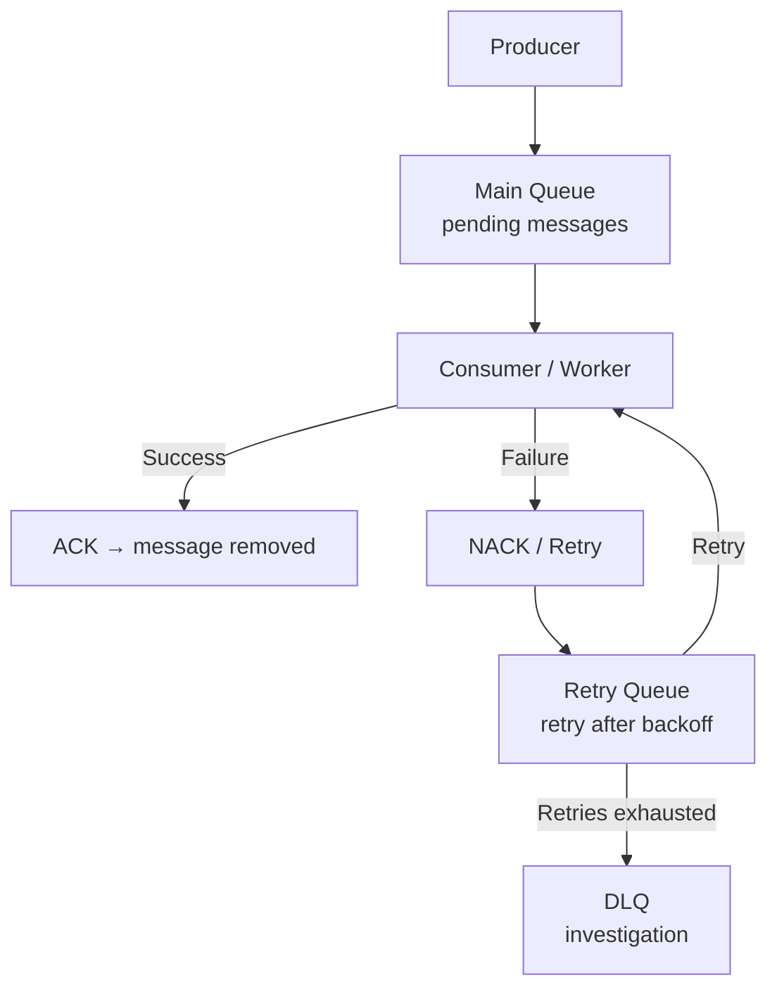

# Queue Terminology

- **Topic:** SYSTEM DESIGN
- **Date:** 04 Nov 2026

## What & Why

- Quick reference for the common **queue types** and **processing terms** used in backend messaging systems (`RabbitMQ`, `Kafka`, `AWS SQS`, `BullMQ`, etc.).
- The concepts are the same across systems; only the naming and implementation differ slightly.

## Main Queue Types

| Queue | Purpose |
|-------|---------|
| **Main Queue** | Newly arrived jobs/messages wait here to be processed. |
| **Retry Queue** | Failed messages are routed here so they can be retried. |
| **DLQ** (Dead Letter Queue) | Messages that failed permanently or exhausted all retries are parked here. |
| **Delay Queue** | Holds a message until its scheduled processing time arrives. |
| **Priority Queue** | High-priority messages are processed first, low-priority ones later. |
| **FIFO Queue** | First-In-First-Out — whatever arrives first is processed first (ordering guaranteed). |
| **Parking Queue** | Temporarily holds messages for manual investigation or later reprocessing. |
| **Scheduled Queue** | Jobs that must execute at a specific future time. |
| **Reply Queue** | Receives responses in the request-response pattern. |

> **Delay vs Scheduled:** Delay = "run after this much time" (relative); Scheduled = "run at this exact time" (absolute). In practice the two overlap significantly.

## Important Processing Concepts

| Term | Meaning |
|------|---------|
| **Producer** | Publishes messages to the queue. |
| **Consumer / Worker** | Reads messages from the queue and processes them. |
| **ACK** (Acknowledgement) | Confirms the message was processed successfully → remove it from the queue. |
| **NACK** (Negative ACK) | Signals that processing failed → retry / DLQ. |
| **Visibility Timeout** | While a worker is processing a message, it stays hidden from other workers (e.g. `SQS`). |
| **Message TTL** | How long a message remains valid — after that it expires (and often moves to the DLQ). |
| **Prefetch Count** | Max number of **unacknowledged** messages a consumer can receive at once (e.g. `RabbitMQ`). |
| **Backoff** | Progressively increase the delay between retries (e.g. 1s → 2s → 4s → 8s). |
| **Consumer Group** | A group of consumers that share and jointly process a topic's messages (`Kafka`). |
| **Idempotent Consumer** | Receiving the same message again does not duplicate side effects (e.g. a payment is not charged twice). |

## Typical Message Processing Flow

1. **Producer** puts the message into the **Main Queue**.
2. **Consumer** picks up the message and processes it.
3. Success → **ACK** → message removed from the queue.
4. Failure → **NACK** → moved to the **Retry Queue**, retried after backoff.
5. Retries exhausted → moved to the **DLQ** for manual investigation.

## Top 5 Concepts for Interviews

1. **DLQ** — repeatedly failing ("poison") messages do not block normal processing.
2. **Retry with exponential backoff** — prevents further overloading an already unhealthy downstream service.
3. **Idempotent consumers** — duplicate delivery does not cause duplicate side effects.
4. **ACK / NACK** — determines whether a message is considered successfully processed.
5. **Visibility timeout** — under normal conditions, two workers do not process the same in-flight `SQS` message.

> **Gotcha:** Most messaging systems provide **at-least-once delivery** — duplicates are possible. Always design consumers to be **idempotent**.
